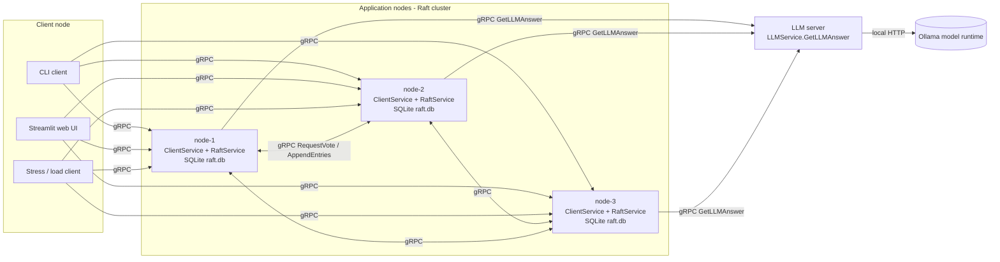

# Distributed Ticket Booking System with gRPC and Raft

Course: **Advanced Operating Systems (CS G623)**, BITS Pilani, First Semester 2026-27
Project option: **A - Distributed Ticket Booking System**

Team: **Pratham Soneja, Rathul Krishnan, Mitali Narayan**

A fault-tolerant ticket booking service. Users sign up, browse shows, see a live seat map,
book up to five seats with a mock payment, cancel with a refund, and ask a support chatbot
backed by a local LLM. Three application servers keep every booking in a replicated log using
the **Raft consensus algorithm**, so the system keeps working, and never double-books a seat,
when a server (including the leader) crashes. All services talk to each other over **gRPC**,
and everything is written in **Python**.

The slide deck is [docs/AOS_Project_Presentation.pptx](docs/AOS_Project_Presentation.pptx), and
individual contributions and learnings are in [docs/Reflection.md](docs/Reflection.md).

---

## 1. How it works (in one page)

1. A **client** (command-line client, web UI, or load generator) calls the gRPC
   `ClientService` on any application node: `Login`, `Signup`, `Logout`, `Get`, `Post`.
2. The three **application nodes** run Raft. One is elected **leader**; the others are
   **followers**.
3. A **write** (book, cancel, signup, login session, logout) must go to the leader. A follower
   answers `NOT_LEADER` with the leader's address and the client retries there.
4. The leader turns the write into a **log entry**, sends it to the followers with
   `AppendEntries`, and **commits** it once a majority (2 of 3) has stored it. Only then is it
   applied to the seat map and the payment ledger, and the client gets `OK`.
5. A **read** (shows, seats, my bookings, price quote, FAQ) is forwarded to the leader, which
   first confirms with a majority that it is still the leader (a *read barrier*), so nobody
   ever sees an out-of-date seat map.
6. If the leader dies, a follower's election timer fires, it asks for votes with
   `RequestVote`, wins a majority, and becomes the new leader. Committed bookings survive
   because a majority already stored them, and a node can only win if its log is up to date.
7. A crashed node restarts from its own SQLite database, replays its committed log, and the
   leader sends it whatever it missed.
8. FAQ questions go from the leader to a separate **LLM server** over gRPC. The LLM server finds
   matching FAQ text, adds the live seat map if relevant, and asks a local model (Ollama,
   `llama3.2:1b`) to answer from that context only. If the LLM is down, the user gets the FAQ
   text itself, clearly labelled, and bookings keep working.

## 2. Architecture



| node (assignment demo setup) | in this project | port |
|---|---|---|
| Node 1: AI/LLM server | `llm` (`ticket_booking.llm_service`) | 50055 |
| Node 2: application server, Raft leader | whichever of `app-1/2/3` wins the election | 50051-50053 |
| Node 3: application server, Raft follower | another `app-N` | 50051-50053 |
| Node 4: additional Raft follower | the third `app-N` | 50051-50053 |
| Node 5: client node(s) | `ui` (Streamlit), CLI, stress client | 8501 (UI) |

gRPC services (`src/proto/ticket_booking.proto`):

| service | RPCs | used by |
|---|---|---|
| `ClientService` | `Login`, `Signup`, `Logout`, `Post(token, type, data, request_id)`, `Get(token, type, params)` | clients -> app nodes, follower -> leader forwarding |
| `RaftService` | `RequestVote(from, to, term, last_log_index, last_log_term)`, `AppendEntries(from, to, term, prev_index, prev_term, commit_index, entries)` | app node <-> app node |
| `LLMService` | `GetLLMAnswer(request_id, query, context)` | app node -> LLM server |

Source layout:

```
docker-compose.yml          5-service topology (+ optional containerised Ollama)
src/proto/                  ticket_booking.proto
src/ticket_booking/
  server.py                 ClientService, read/write routing, FAQ boundary
  raft_node.py              Raft: election, replication, commit, read barrier
  raft_storage.py           durable term/vote/log/commit index (SQLite)
  raft_service.py           RaftService gRPC adapter
  application.py            business layer: validation, pricing, Raft commands
  state_machine.py          seat map, bookings, per-seat locks, idempotency
  auth.py                   PBKDF2 passwords, hashed session tokens
  payment.py                mock payments and refunds
  llm_service.py            LLM gRPC server (FAQ retrieval + Ollama)
  faq_data.py, seed.py      FAQ retrieval, domain check, SQLite catalogue
  client.py                 gRPC client library + CLI
  healthcheck.py            container health probes
  stress_test_clients.py    basic race / idempotency load script
src/ui/                     Streamlit UI (gRPC client only)
src/scripts/                proto generation, stress test, Docker/UI verification
src/tests/                  unit, integration, Raft, fault-injection, UI tests
```

## 3. System design choices

| choice | why |
|---|---|
| Raft (leader-based consensus) | One leader orders every booking, so two clients can never both win a seat; a majority quorum tolerates one failed node out of three. |
| Writes acknowledged only after majority commit | A booking the client was told about can never be lost by a crash. |
| Linearizable reads via a ReadIndex barrier | A leader cut off from the others could otherwise show a stale seat map; it must reconfirm leadership with a majority before answering. |
| Followers redirect writes, forward reads | Clients may contact any node; correctness does not depend on knowing the leader. |
| Request IDs on every write, deduplicated in the log, the seat map and the payment ledger | Clients can safely retry after a timeout or failover without double booking or double charging. |
| Deterministic state machine (payment decision made before the entry is logged) | Every node applies the same entries and ends in the same state; nodes never call a payment provider independently. |
| SQLite per node, `synchronous=FULL` | Term, vote and log survive crashes; simple, embedded, no extra server. |
| Per-seat locks taken in sorted order | Multi-seat bookings are atomic and deadlock-free. |
| Server-side pricing | The server charges `price x seats`; the client cannot set the price. |
| LLM on a separate gRPC server; its output is read-only text | Meets the "separate LLM server" requirement; a model answer can never change bookings or payments. |
| Booking keeps working when the LLM is down | The chatbot is not on the critical path. |
| Docker Compose, one image for all services, named volumes | Reproducible 5-node demo; data survives restarts. |
| Streamlit UI that only uses the gRPC client | The UI is just another client; it cannot bypass consensus. |

## 4. Features

- Sign up, log in, log out; salted PBKDF2 password hashes; expiring session tokens (only token
  hashes are replicated).
- Browse 8 seeded shows with 50 seats each; live, linearizable seat availability.
- Book 1-5 seats atomically; server-side price quote; mock card that approves or declines.
- My Bookings with charge status; cancel with automatic refund; owner checks (a user cannot
  see or cancel someone else's booking).
- Idempotent retries via request IDs.
- **Raft consensus proof** (novelty): every booking reply carries a receipt from the leader
  (leader, term, log index, commit index, last applied, committed, replayed). The web UI shows it
  as a booking-lifecycle panel; the CLI prints it after `--action book`.
- Raft: leader election, log replication, majority commit, persistence, crash recovery,
  follower catch-up, linearizable reads, no-quorum safety.
- Context-aware FAQ chatbot on a separate LLM server: FAQ retrieval + live seat map, off-topic
  questions rejected, labelled fallback when the model is unavailable.
- Streamlit web UI with three views: **Booking**, **Cluster Observatory** (live role, term,
  log, commit index, replication lag, state digest per node) and **Demo Lab** (concurrent seat
  race, same-key retry, measured leader failover, no-quorum scenario, timeline, downloadable
  summary).
- Command-line client for every operation.
- Stress test with leader failure and invariant checks.
- Docker Compose topology with health checks and persistent volumes.
- Automated tests: unit, gRPC integration, Raft cluster, RPC fault injection (delayed,
  dropped, duplicated, reordered messages), election churn, UI.

## 5. Setup and run

### Requirements

- Windows, macOS or Linux; Python 3.13; Git
- Docker Desktop (for the 5-node topology)
- Ollama with the model `llama3.2:1b` (`ollama pull llama3.2:1b`), or use the containerised
  Ollama option below

### Option A: Docker Compose (recommended)

From the repository root:

```bash
docker compose build
```

```bash
docker compose up -d
```

The `llm` service finds Ollama on the host automatically (and falls back to the optional
`ollama` container), so no environment variable is needed.
Without host Ollama, run Ollama in a container instead (the first start downloads the Ollama
image, several GB, and the ~1.3 GB model):

```bash
docker compose --profile ollama up -d
```

Check status, then open the UI at http://127.0.0.1:8501:

```bash
docker compose ps
```

Useful commands:

| purpose | command |
|---|---|
| logs | `docker compose logs -f app-1 app-2 app-3` |
| which node is leader | `python -m ticket_booking.client --server 127.0.0.1:50051 --action status` (repeat for 50052, 50053) or the UI's Cluster Observatory |
| kill / restart a node | `docker compose stop app-2` / `docker compose start app-2` |
| stop, keep data | `docker compose down` |
| stop and **delete all data** | `docker compose down -v` |

Seeded demo accounts: `alice` / `wonderland`, `bob` / `builder`, `user1`..`user32` /
`pass1`..`pass32`. Mock cards: `4242424242424242` approves; any number starting or ending in
`0000` (e.g. `4000000000000000`) is declined.

### Option B: local processes

From `src`:

```bash
python -m venv .venv
```

Activate it (`.\.venv\Scripts\Activate.ps1` on Windows, `source .venv/bin/activate` elsewhere), then:

```bash
python -m pip install -r requirements.txt
```

```bash
python scripts/generate_proto.py
```

```bash
python -c "import nltk; nltk.download('stopwords')"
```

Start the LLM server and three Raft nodes, each in its own terminal:

```bash
python -m ticket_booking.llm_service
```

```bash
python -m ticket_booking.server --node-id node-1 --peers node-1=127.0.0.1:50051,node-2=127.0.0.1:50052,node-3=127.0.0.1:50053 --data-dir data/node-1
```

```bash
python -m ticket_booking.server --node-id node-2 --peers node-1=127.0.0.1:50051,node-2=127.0.0.1:50052,node-3=127.0.0.1:50053 --data-dir data/node-2
```

```bash
python -m ticket_booking.server --node-id node-3 --peers node-1=127.0.0.1:50051,node-2=127.0.0.1:50052,node-3=127.0.0.1:50053 --data-dir data/node-3
```

Web UI:

```bash
python -m streamlit run ui/app.py
```

A single non-replicated server (`python -m ticket_booking.server`) is still supported for
simple testing.

### Command-line client (from `src`)

```bash
python -m ticket_booking.client --action shows
```

| action | example |
|---|---|
| sign up | `--action signup --username charlie --password GoodPass1` |
| seats | `--action seats --show-id show-1` |
| book (up to 5) | `--action book --show-id show-1 --seat-id A1,A2,A3` (also prints the Raft receipt) |
| declined payment | `--action book --show-id show-1 --seat-id A9 --card 4000000000000000` |
| my bookings | `--action mybookings` |
| cancel | `--action cancel --booking-id <id>` |
| FAQ | `--action faq --query "How do I cancel a booking?"` |
| node status | `--server 127.0.0.1:50052 --action status` |
| analytics | `--action analytics` |

Other options: `--server`, `--username`, `--password` (defaults `alice` / `wonderland`).

### Tests and load scripts

From `src`:

```bash
python -m pytest
```

The LLM tests need Ollama running with `llama3.2:1b`. With the Docker cluster running, from
the repository root:

```bash
python src/scripts/stress_m2.py --duration 30 --workers 12 --failover docker
```

```bash
python src/scripts/verify_docker.py
```

```bash
python src/scripts/verify_ui_docker.py
```

From `src`, a self-contained end-to-end demo (starts three local nodes, races 10 users for one
seat, kills the leader, books after failover, restarts the node and checks catch-up):

```bash
python scripts/m2_demo.py --skip-faq
```

From `src`, the basic race/idempotency script:

```bash
python -m ticket_booking.stress_test_clients --server 127.0.0.1:50051 --race-workers 15
```

### Code style

Formatting and linting use Ruff, configured in `src/pyproject.toml` (line length 120,
generated protobuf code excluded). From `src`, with Ruff installed (`pip install ruff`):

```bash
ruff format .
```

```bash
ruff check .
```

## 6. Team contributions

All three members contributed equally to design, implementation, testing, debugging,
deployment and documentation across the whole project.

**Pratham Soneja**
- Seat-allocation state machine: per-seat locking, atomic multi-seat bookings, request-ID
  idempotency.
- Raft core: leader election, log replication, majority commit and the linearizable read
  barrier.
- gRPC client library and command-line client, including leader redirection and retries.
- Raft correctness tests, including RPC fault injection and election-churn tests.

**Rathul Krishnan**
- gRPC application server: request routing, follower forwarding and session handling across
  nodes.
- Raft persistence and recovery: SQLite storage of term, vote and log, replay on restart,
  follower catch-up.
- Docker Compose deployment: one image, health checks, named volumes, 5-node topology.
- Integration tests, the stress-testing tool and the Docker verification workflow.

**Mitali Narayan**
- Separate LLM server: gRPC `LLMService`, Ollama integration, FAQ retrieval with NLTK, domain
  check and safe fallback.
- SQLite catalogue and seed data for shows and FAQs; mock payment, pricing and refund
  handling.
- Streamlit web UI: Booking view, Cluster Observatory and Demo Lab.
- Raft consensus proof novelty: commit receipt from the leader, booking-lifecycle panel in the
  UI, and the end-to-end demo script `src/scripts/m2_demo.py`.
- LLM, payment and UI tests, and the UI verification workflow.

## 7. Security notes and limitations

- Passwords: salted PBKDF2-SHA256. Session tokens are random; only their SHA-256 hash is
  stored and replicated. LLM requests carry a fresh correlation ID, never the session token.
- Payments are mock only; no real card data is used.
- gRPC runs without TLS and is bound to 127.0.0.1 in Compose; do not expose it publicly.
- Limitations: no log compaction or snapshots, fixed cluster membership (3 nodes), no leader
  lease (an isolated leader keeps its role but cannot commit or serve reads), and the chatbot's
  topic filter is vocabulary based.

Reference: D. Ongaro and J. Ousterhout, "In Search of an Understandable Consensus Algorithm
(Extended Version)".
