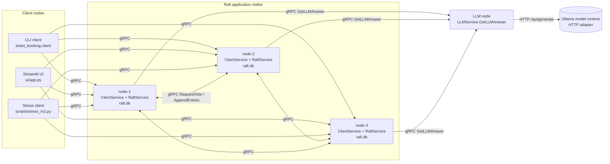

# Distributed Ticket Booking System

This system is intended to serve as a dependable platform for booking tickets concurrently. It demonstrates how clients and servers communicate through gRPC, how in-memory state is managed in a thread safe manner using a mutex, and how shows and FAQs are stored persistently in SQLite. Payment handling is carried out with deterministic mock logic, the cluster leader is redirected in a transparent way, and questions posed in natural language are answered by a locally hosted language model.

The M2 app-server mode uses Raft for leader election, replicated logs, majority commits, and follower recovery. Each app node keeps its Raft term, vote, and log in a separate SQLite database; the catalog database remains unchanged.

## 1. Main Features and Technologies

Main features:

- User registration and authentication with password hashing and expiring session tokens
- Browse show schedules and real-time seat availability
- Multi-seat reservations up to 5 seats per request
- Concurrent booking protection using ordered per-seat locks
- Idempotent request handling
- Raft-backed three-node booking replication and leader failover
- Mock payment and refund handling
- Context-aware support chat and an Ollama LLM service
- Client redirection from follower nodes to the leader node
- Automated unit, integration, and concurrency stress tests

Technologies:

- Python 3.13
- gRPC 
- Protocol Buffers 
- SQLite3 
- Ollama
- NLTK 3.10.3
- Pytest 8.4.2


## 2. How the Client, Server, Database, and Ticket Booking Flow Work

System architecture:

- Client: Through gRPC stubs, a Python command-line interface talks to the server. The session token is kept after login, and when write requests land on follower nodes, the client follows the leader redirection on its own.
- Server: Client requests are handled by a gRPC application server. In M2 mode, Raft elects a leader, replicates commands, and applies them after a majority commit. Followers forward reads to the leader and redirect writes; the leader answers reads only after a ReadIndex barrier (see section 12). Signup, login sessions, and logout are kept usable across nodes.
- Database: Static show schedules and support FAQ topics sit in an embedded SQLite database (catalog. db). If the tables are empty when the process starts, seed data is loaded into SQLite.
- LLM Service: A separate gRPC service (LLMService) finds matching FAQ documents through keyword overlap and NLTK stopwords, takes live seat availability from the application server, and calls Ollama at [http://127.0.0.1:11434/api/generate](http://127.0.0.1:11434/api/generate).

Ticket booking flow:

1. The client is where the user logs in or signs up. Once the credentials pass verification on the server side, a 32-byte session token comes back in the response.
2. A request then goes out for the available shows, or for the seats at one particular show. Catalog data and the live seat map are both queried by the server.
3. For a booking, the user sends in a request that names the show ID and the seat IDs, along with the payment card details.
  Should the request land on a follower node, that follower answers with status NOT_LEADER and passes back the leader address. The client then reconnects to the leader.
4. At the leader, the session token is validated, and a check is made as to whether that request ID has been dealt with before.
5. The leader goes through every requested seat in sorted order and takes out locks on them, which is what keeps deadlocks from arising.
6. The leader verifies that all requested seats are currently AVAILABLE. If any seat is already booked, the request fails with status ALREADY_BOOKED.
7. If seats are available, the leader processes the mock payment. Cards starting or ending with 0000 are declined with PAYMENT_FAILED, leaving seats unreserved.
8. Upon successful payment, seats transition to BOOKED status with the user ID and generated booking ID. The booking record is saved and the result is returned to the client.
9. If the user cancels a booking, the leader verifies ownership, marks seats back to AVAILABLE, sets booking status to CANCELLED, and issues an automatic refund.


## 3. Requirements

System requirements:

- Operating System: Windows
- Python: Version 3.13
- Git
- Ollama


## 4. Complete Project Setup

Run from inside the src directory.

Windows (PowerShell):

```powershell
cd src
python -m venv .venv
.\.venv\Scripts\Activate.ps1
python -m pip install -r requirements.txt
python scripts\generate_proto.py
python -c "import nltk; nltk.download('stopwords')"
```

LLM setup for FAQ service:

1. Install Ollama from [https://ollama.com](https://ollama.com)
2. Pull the required language model:

```bash
ollama pull llama3.2:1b
```

Keep the Ollama application or daemon running in the background.

## 5. Server Installation and Start Command

Step 1: Start the LLM FAQ service (Terminal 1):

```bash
python -m ticket_booking.llm_service
```

This runs the FAQ gRPC service on port 50055.

Step 2: Start the application server (Terminal 2):

```bash
python -m ticket_booking.server
```

This starts the leader application server on port 50051.

(Optional) follower node setup: To run an additional follower node that redirects writes to the leader:

```bash
python -m ticket_booking.server --follower --leader 127.0.0.1:50051 --port 50052
```

This legacy single-server/follower setup remains for M1 compatibility. For M2, start each app process with the same peer list and its own persistent data directory. From `src`, start the FAQ server in a separate terminal if FAQ requests are needed:

```powershell
python -m ticket_booking.llm_service
```

Then start the three app processes from `src`:

```powershell
python -m ticket_booking.server --node-id node-1 --peers node-1=127.0.0.1:50051,node-2=127.0.0.1:50052,node-3=127.0.0.1:50053 --data-dir data\node-1
```

```powershell
python -m ticket_booking.server --node-id node-2 --peers node-1=127.0.0.1:50051,node-2=127.0.0.1:50052,node-3=127.0.0.1:50053 --data-dir data\node-2
```

```powershell
python -m ticket_booking.server --node-id node-3 --peers node-1=127.0.0.1:50051,node-2=127.0.0.1:50052,node-3=127.0.0.1:50053 --data-dir data\node-3
```

Wait for the election log, then send client requests to any app address. `--peers` includes every node, including the current node. `--client-addresses` is optional and defaults to `--peers`; set it when clients use different hostnames or published ports than the nodes use for Raft communication. Raft state is written to `<data-dir>/raft.db`; do not reuse a data directory for multiple nodes. A read sent to a follower is forwarded to the leader, which serves it only after confirming its leadership with a majority (linearizable reads; see section 12).

For Docker Compose see section 13. The app nodes are published on localhost ports 50051–50053, and advertised client addresses use those ports so redirects work from the host. For another-machine access, configure host bindings and `--client-addresses` for reachable addresses; do not expose these plaintext gRPC ports to an untrusted network. Raft state lives in the named volumes `node-1-data`, `node-2-data`, `node-3-data` (the old `.data/` bind mounts are no longer used).

Available server command-line options:

- --port: Listening port for the application server (default: 50051)
- --llm-server: Address of the LLM service (default: 127.0.0.1:50055)
- --follower: Run in follower mode (redirects write requests to leader)
- --leader: Address of cluster leader to provide in redirect responses (legacy mode)
- --node-id: Raft identity for this app node
- --peers: Comma-separated node-id=host:port list including this node
- --client-addresses: Optional client-reachable node-id=host:port list for follower redirects
- --data-dir: Persistent directory for this node's SQLite Raft database


## 6. Client Installation and Start Command

Run the commands from the src directory in the virtual environment.

List shows:

```bash
python -m ticket_booking.client --action shows
```

List seats for a show:

```bash
python -m ticket_booking.client --action seats --show-id show-1
```

Book a single seat:

```bash
python -m ticket_booking.client --action book --show-id show-1 --seat-id A1
```

Book multiple seats (up to 5 seats):

```bash
python -m ticket_booking.client --action book --show-id show-1 --seat-id A1,A2,A3
```

List your own bookings (booking IDs, status, charge count, refund):

```bash
python -m ticket_booking.client --action mybookings
```

Cancel a booking:

```bash
python -m ticket_booking.client --action cancel --booking-id <booking_id_from_booking>
```

Book with the declining mock card (no booking, no charge):

```bash
python -m ticket_booking.client --action book --show-id show-1 --seat-id A9 --card 4000000000000000
```

Ask an FAQ support question:

```bash
python -m ticket_booking.client --action faq --query "How do I cancel a booking?"
python -m ticket_booking.client --server 127.0.0.1:50052 --action status
python -m ticket_booking.client --action analytics
```

Register a new user account:

```bash
python -m ticket_booking.client --action signup --username charlie --password GoodPass1
```

Client command-line options:

- --server: Target server address (default: 127.0.0.1:50051)
- --username: Username for authentication (default: alice)
- --password: Password for authentication (default: wonderland)
- --action: Operation to execute (signup, shows, seats, book, cancel, mybookings, faq, status, analytics; default: shows)
- --show-id: Show identifier for seats, bookings, or FAQs (default: show-1)
- --seat-id: Seat identifier or comma-separated list of up to 5 seats (default: A1)
- --booking-id: Booking identifier used for cancellations
- --card: Mock card number for bookings (default 4242424242424242 approves; numbers starting or ending in 0000 are declined)
- --query: Support question string for FAQ requests


## 7. Database Setup

Database setup:

- Database engine: SQLite3
- Database location: src/ticket_booking/catalog.db
- Initialization: src/ticket_booking/seed.py.
- Seed data:
  - 8 shows (show-1 through show-8), each initialized with 50 seats (A1 to A50).
  - 6 policy and FAQ documents covering cancellation rules, refund policies, booking procedures, advance booking windows, seat change policies, and seat availability.
- Default user credentials:
  - alice / wonderland
  - bob / builder
  - user1 through user32 with passwords pass1 through pass32


## 8. How Clients Send Requests to the Server

Communication protocol:

- Clients connect to the server using gRPC over HTTP/2 with binary Protocol Buffers serialization.
- REST and traditional HTTP clients (such as standard curl, browser URLs, or standard Swagger OpenAPI endpoints) are not supported directly because the endpoints are binary gRPC services.
- If using an external API tool like Postman or grpcurl, select gRPC request mode and import src/proto/ticket_booking.proto to interact with the service methods.

Request handling:

- Session tokens: The client calls Login or Signup to obtain an authentication token, which must be passed in all subsequent Get and Post requests.
- Redirection: When a write request (Post) is sent to a follower node, the follower replies with status NOT_LEADER and provides the leader address in redirect_to. The client closes the follower connection, opens a channel to the leader, and repeats the request.


## 9. Testing Instructions

From the src directory in virtual environment:

```bash
python -m pytest
```

Running individual test suites:

```bash
python -m pytest tests/test_proto.py
python -m pytest tests/test_raft.py
python -m pytest tests/test_auth.py
python -m pytest tests/test_booking.py
python -m pytest tests/test_payment.py
python -m pytest tests/test_client.py
python -m pytest tests/test_llm.py
python -m pytest tests/test_integration.py
```

Note regarding LLM tests:
Tests in test_llm.py and the test_cancel_faq test in test_integration.py require Ollama to be running with the llama3.2:1b model pulled. If Ollama is offline, LLM tests report UNAVAILABLE.

Running multi-threaded stress and race condition tests:
From the src directory with the server running:

```bash
python -m ticket_booking.stress_test_clients --server 127.0.0.1:50051 --race-workers 15
```

This script runs three phases:

- Concurrent browsing across multiple user sessions
- 15 concurrent threads racing to book the exact same seat
- Concurrent retries with identical request_id


## 10. Team Contributions

All three members of the team contributed equally in the development, testing, debugging, documentation, deployment and final completion of this project.

Pratham Soneja:

- Backend and State Machine: Developed the in-memory seat allocation state machine, fine-grain seat locking mechanism and multi-seat transaction handling.
- Concurrency and Testing: Built tools for concurrency stress testing and unit test suites to test race conditions and idempotent replay of requests.
- Client and API Routing: Built the command line client interface, session token lifecycle and the follower to leader transparent redirection logic.

Rathul Krishnan:

- Developed end-to-end integration tests with gRPC channels for multi-user browsing, booking and cancelation flows.
- System Debugging: Fixed thread sync edge cases, tested gRPC channel reliability under multi-connection loads.
- Deployment & Documentation: Organized virtual environment setup, dependency configuration, and project documentation.

Mitali Narayan:

- LLM Service and Database: Built gRPC LLM service, Ollama integration and SQLite database catalog schema with automated seeding for shows and FAQ entries.
- Retrieval Engine and Payments: NLTK keyword scoring for domain FAQ retrieval, deterministic mock payment and refund handling.
- Project Test and Collaboration: Synchronized test suite execution between components, checked API contract adherence to protobuf definitions, helped with documentation..


## 11. Milestone 2 Architecture



Every hop between project services is gRPC. The one non-gRPC hop is inside the LLM node:
`llm_service.py` calls the Ollama model runtime over its local HTTP API. Ollama is treated as
the model-runtime adapter of the LLM server, not as a separate project service.

Booking and failover sequence:

```mermaid
sequenceDiagram
    participant C as Client
    participant F as Follower
    participant L as Leader (term T)
    participant P as Other follower
    C->>F: Post BOOK_SEAT(token, request_id)
    F-->>C: NOT_LEADER, redirect_to = leader
    C->>L: Post BOOK_SEAT(token, request_id)
    L->>L: validate token, check request_id, mock-payment check, append entry
    par replicate
        L->>F: AppendEntries(entry)
        L->>P: AppendEntries(entry)
    end
    F-->>L: success, matchIndex
    L->>L: majority -> commit -> apply (seat BOOKED, charge recorded once)
    L-->>C: OK, booking_id
    Note over L: leader crashes
    F->>F: election timeout, term T+1
    F->>P: RequestVote(T+1, lastLogIndex, lastLogTerm)
    P-->>F: vote granted (F's log is at least as up to date)
    Note over F: new leader; commits a NOOP in T+1 on first read
    C->>F: Get SEATS (retry after UNAVAILABLE)
    F->>P: heartbeat round (ReadIndex confirmation)
    P-->>F: ack in term T+1
    F-->>C: seat BOOKED (read-after-write holds)
```


## 12. Consistency Semantics

| operation | guarantee | mechanism |
|---|---|---|
| `Post BOOK_SEAT` / `CANCEL_SEAT`, signup, login session, logout | linearizable; acknowledged only after a majority commit | leader appends to the Raft log, replies after commit + apply (`RaftNode.propose`) |
| `Get SHOWS`, `SEATS`, `MY_BOOKINGS`, `QUOTE`, `BOOKING_ANALYTICS`, `FAQ` | linearizable | followers forward to the leader; the leader runs `RaftNode.read_barrier()` (commits a NOOP in its term if needed, confirms leadership with a majority heartbeat round started after recording the read index, waits until applied) |
| `Get CLUSTER_STATUS` | local, per node, not linearizable (diagnostic) | answered by the node that received it |
| retries with the same `request_id` | at most one booking and one logical charge | request-ID dedup in the log (`propose`), in the state machine (`SeatMap`), and in `Payments.apply_charge` |
| no majority | writes are not acknowledged (`NO_QUORUM`/`UNAVAILABLE`), reads are refused (`NO_QUORUM`) | commit and read barrier both require a majority |
| LLM answers | read-only text; never parsed or applied to state | FAQ is a `Get`; nothing returned by the LLM reaches `propose` |

An uncommitted entry left on a leader that lost its majority may still commit later when the
majority returns (standard Raft); a client that retries with the same `request_id` receives the
same single outcome.


## 13. Docker

Topology: one image `ticket-booking:m2`; services `llm`, `app-1`, `app-2`, `app-3`, `ui`
(plus optional `ollama`, `ollama-pull` under the `ollama` profile). Distinct node IDs and
named volumes `node-1-data`..`node-3-data`; static peer list using compose service names;
health checks on every service; the UI has no volumes and no Docker socket. Raft nodes do
not wait for the LLM. Verified run: [docs/docker-verification.md](docs/docker-verification.md).

Run from the repository root.

Build and start (choose how the LLM node reaches a model runtime):

```bash
docker compose build
```

```bash
OLLAMA_URL=http://host.docker.internal:11434/api/generate docker compose up -d
```

```bash
docker compose --profile ollama up -d
```

The first form uses Ollama installed on the host (`ollama pull llama3.2:1b` first); the second
runs Ollama in a container and pulls the model on first start. With neither, FAQ replies are
labelled fallbacks (verbatim FAQ text). In PowerShell set the variable first:
`$env:OLLAMA_URL="http://host.docker.internal:11434/api/generate"; docker compose up -d`.

Status and logs:

```bash
docker compose ps
```

```bash
docker compose logs -f app-1 app-2 app-3
```

Identify the leader (host CLI, from `src` with the venv active; repeat for ports 50052 and
50053, or open the UI's Cluster Observatory at http://127.0.0.1:8501):

```bash
python -m ticket_booking.client --server 127.0.0.1:50051 --action status
```

Leader stop and restart (replace `app-2` with the leader's service):

```bash
docker compose stop app-2
```

```bash
docker compose start app-2
```

No-quorum demo: stop two app services, try a booking (it is not acknowledged and reads return
`NO_QUORUM`), start them again and retry with the same request ID (UI Demo Lab, step 4):

```bash
docker compose stop app-1 app-3
```

```bash
docker compose start app-1 app-3
```

Stop while keeping data, or reset everything:

```bash
docker compose down
```

```bash
docker compose down -v
```

`down` keeps the Raft volumes, so the next `up` replays the committed logs. `down -v` is
destructive: it deletes all Raft logs, bookings and sessions.

Automated Docker verification and stress test (repository root, cluster running):

```bash
src/.venv/Scripts/python.exe src/scripts/verify_docker.py
```

```bash
src/.venv/Scripts/python.exe src/scripts/stress_m2.py --duration 30 --workers 12 --failover docker
```

```bash
src/.venv/Scripts/python.exe src/scripts/verify_ui_docker.py
```

`verify_docker.py` stops/starts containers and runs `docker compose down` + `up -d` (volumes kept).
`verify_ui_docker.py` drives every Streamlit view headlessly (`AppTest`) against the running
cluster over gRPC, stopping/starting app and LLM containers for the failure flows.


## 14. Web UI (Streamlit, gRPC client only)

The UI imports only `ticket_booking.client.Client`; it has no database access, no server-side
imports, no shell or Docker access.

- **Booking**: login/signup, show picker, labelled seat grid (booked seats disabled), up to 5
  seats, server-side quote (`Get QUOTE`), mock card that approves or declines, confirmation with
  booking and request IDs, My Bookings with charge count, cancellation + refund, FAQ chat that
  labels answers as LLM-generated, fallback (verbatim FAQ text) or out-of-domain and shows the
  supporting context and correlation ID. Loading spinners, disconnected/no-quorum/no-leader
  messages, and a STALE banner when a live read fails and the last confirmed seat map is shown.
- **Cluster Observatory**: one `CLUSTER_STATUS` RPC per node: reachability (UNREACHABLE is
  distinct from follower), role, term, leader, log length, commit/applied index, commit lag and
  leader matchIndex, committed-log digest and state digest, plus a sampled lag chart.
- **Demo Lab** (novelty): concurrent seat race, same-key retry, guided leader failure with
  measured failover time and old-leader catch-up check, guided no-quorum scenario, a
  timestamped timeline correlated by request ID, invariant checks computed from real responses,
  and downloadable Markdown/JSON summaries. Node stops are done by the operator in a terminal;
  the UI shows the exact command.

Local (from `src`, cluster running on 50051-50053; Streamlit is installed by `requirements.txt`):

```bash
python -m streamlit run ui/app.py
```

Docker: http://127.0.0.1:8501.

### 14a. The Night Programme (custom web UI + local HTTP gateway)

A second, art-directed interface over the same cluster. The Streamlit UI above is unchanged and
remains the fallback. Browsers cannot call plain gRPC, so a small standard-library HTTP gateway
(`src/web/gateway.py`) translates: **browser → gateway (127.0.0.1:8600) → gRPC nodes**. The
gateway reuses `ticket_booking.client.Client` and `ui/cluster.py`; it adds no dependencies and
holds no booking, payment or auth rules.

From `src`, with the three nodes (and optionally the FAQ service) running as in section 5:

```powershell
.\.venv\Scripts\python.exe -m web.gateway
```

Open http://localhost:8600. Details, security model and limitations: [src/web/README.md](src/web/README.md).
Tests: `python -m pytest tests/test_web_gateway.py`.


## 15. Failure Demonstrations (local processes)

Start the LLM service and three nodes as in section 5, then from `src`:

```bash
python -m ticket_booking.client --action book --show-id show-1 --seat-id A10
```

Stop the leader's terminal (Ctrl+C), then query another node:

```bash
python -m ticket_booking.client --server 127.0.0.1:50052 --action seats --show-id show-1
```

A10 is still `BOOKED`. Restart the stopped node with its original command and data directory;
it rejoins as follower and catches up (`--action status` on its port shows the same
commit index).


## 16. Test Suites (Milestone 2 additions)

From `src`:

```bash
python -m pytest
```

```bash
python -m pytest tests/test_raft_m2.py tests/test_m2_features.py tests/test_ui.py
```

- `tests/test_raft_m2.py`: follower commit rule, read barrier, deposed-leader stale-read
  regression, follower-read forwarding, read-after-write across failover, no-quorum booking with
  same-ID retry, real gRPC fault injection (delayed / dropped request / dropped response /
  duplicated / reordered `AppendEntries` and `RequestVote`), booking under election churn.
- `tests/test_m2_features.py`: LLM correlation IDs, out-of-domain rejection, LLM outage
  fallback (dead port, runtime abort, not configured), generated text cannot mutate state,
  My Bookings / Quote / refund, payment decline, client redirect map, status digests.
- `tests/test_ui.py`: UI import boundary, Observatory and Demo-Lab helpers against a live
  3-node cluster, headless Streamlit (`AppTest`) runs of all three views.
- `tests/test_final_quality.py`: server-side pricing, retry with an unnormalized seat list, request-ID index (no log scan, rebuilt on restart, pruned on truncation), FAQ domain gate, CLI `mybookings`/`--card`, cross-user cancellation.
- `tests/raft_faults.py` is a helper module (fault-injecting gRPC interceptor), not a test file.

The LLM tests in `test_llm.py` and `test_integration.py::test_cancel_faq` still need a running
Ollama with `llama3.2:1b`.


## 17. Requirement → Implementation → Test → Demo

| requirement (assignment PDF, option A) | implementation | tests | demo |
|---|---|---|---|
| gRPC for all inter-service calls, Python only | `proto/ticket_booking.proto`, `server.py`, `raft_service.py`, `llm_service.py`, `client.py` | `test_proto.py`, `test_integration.py` | every scenario |
| leader election | `RaftNode._elect`, `request_vote` | `test_raft.py::test_single_leader_election_stays_stable_under_repeated_failover`, `test_raft_m2.py::test_fault_injected_raft_rpcs_keep_safety` (one leader per term) | Observatory; `verify_docker.py` §2, §4 |
| log replication + majority commit | `append_entries`, `_replicate_peer`, `_advance_commit` | `test_raft.py::test_cluster_commits_same_log_after_write_burst_and_leader_change`, `test_raft_m2.py::test_follower_commit_is_bounded_by_last_new_entry` | log/state digests in Observatory |
| failure detection & recovery, demo after leader kill | election timeout, persisted term/vote/log, replay on start | `test_raft.py::test_cluster_election_replication_failure_and_catchup`, `test_raft_m2.py::test_read_after_write_survives_leader_failover`, `test_concurrent_booking_during_election_churn` | Demo Lab step 3; `verify_docker.py` §4-5 |
| strong consistency for critical operations | majority commit for writes; `read_barrier` for reads | `test_raft_m2.py::test_partitioned_old_leader_does_not_serve_stale_seat_map`, `test_no_quorum_booking_has_no_side_effects_and_retry_is_idempotent` | Demo Lab step 4; `verify_docker.py` §6 |
| overbooking prevention | per-seat ordered locks + Raft-ordered apply + request-ID dedup | `test_booking.py`, `test_raft.py`, `test_raft_m2.py` churn/fault tests | Demo Lab steps 1-2; stress race |
| mock payment, decline, refund | `payment.py`, `application.raft_post/apply_raft` | `test_payment.py`, `test_m2_features.py::test_payment_decline_creates_no_booking_or_charge`, `test_my_bookings_quote_and_refund` | Booking view |
| LLM FAQ on a separate server, context aware | `llm_service.py`, `AppServer._faq` (FAQ retrieval + live seat map) | `test_llm.py`, `test_m2_features.py` LLM tests | Booking view FAQ; `verify_docker.py` §7 |
| web UI (Booking, Cluster Observatory, Demo Lab), gRPC only | `ui/app.py`, `ui/cluster.py` | `test_ui.py` (8 tests incl. headless AppTest) | `scripts/verify_ui_docker.py`; http://127.0.0.1:8501 |
| stress testing | `scripts/stress_m2.py` | churn + fault-injection tests | [docs/stress-test-report.md](docs/stress-test-report.md) |
| 4-5 node demo setup | `docker-compose.yml` (LLM, 3 Raft nodes, UI client) | `verify_docker.py` | [docs/docker-verification.md](docs/docker-verification.md) |


## 18. Security Notes, Limitations, Attribution

Security notes:

- Passwords are stored as salted PBKDF2-SHA256; session tokens are random 32-byte values and
  only their SHA-256 hash is replicated through Raft.
- The LLM request ID is a fresh correlation ID (`faq-<uuid>`), never the session token; the
  LLM receives only the question and grounding context.
- Payments are mock only. The UI offers two labelled mock cards; no real card data is used.
- gRPC is plaintext and unauthenticated between nodes; ports are bound to 127.0.0.1 in compose.
  Do not expose them on an untrusted network.
- `CLUSTER_STATUS` requires a valid session and returns only Raft metadata and digests.

Known limitations:

- No log compaction or snapshots; the log and the in-memory request-ID index grow with every
  write (lookups are O(1); startup replays the whole log).
- No membership changes; the peer list is static.
- No leader lease / check-quorum: an isolated leader keeps its role until it hears a higher
  term, but it can neither commit writes nor serve reads (read barrier).
- `CLUSTER_STATUS` is node-local and may lag; the FAQ domain gate is a fixed vocabulary plus FAQ retrieval, so an off-topic question that uses a booking word ("show me a joke") can still reach the model, which is instructed to answer only from the FAQ context.
- Seeded demo accounts (`alice`/`wonderland`, ...) exist on every node for demonstration.

Attribution: Raft follows Ongaro and Ousterhout, "In Search of an Understandable Consensus
Algorithm (Extended Version)"; the read barrier is the ReadIndex approach from section 8 of
that paper. Third-party software: gRPC/protobuf, SQLite, NLTK stopwords, Ollama with
`llama3.2:1b`, Streamlit. Milestone 2 hardening, tests, UI and documentation were developed
with assistance from an AI coding assistant (Claude); see the reflection template for
individual contributions.
